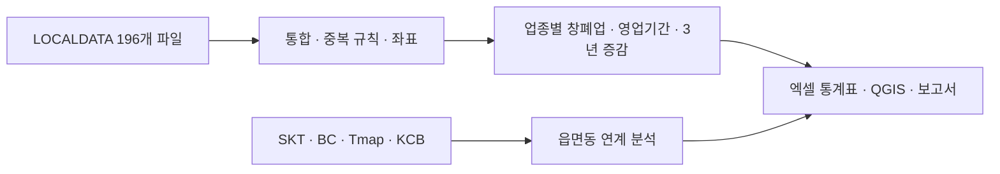
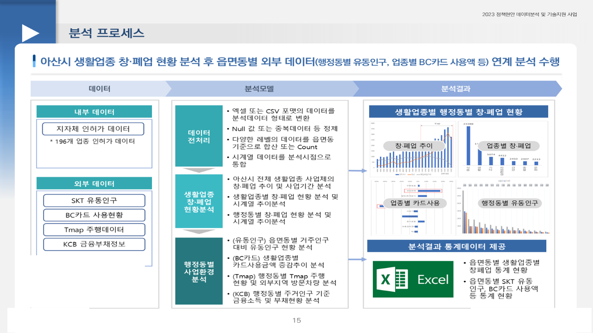

# 아산시 생활업종 빅데이터 분석

2023.11 – 2023.12 · 라임솔루션 / 충남 아산시(지역경제과) · 역할: 전 과정(인허가 데이터 통합·창폐업 분석·외부데이터 연계·보고서)

## 프로젝트 소개
지방행정 인허가(LOCALDATA) 196개 업종 파일을 통합해 생활업종별·읍면동별 창폐업과 영업기간 추세를 산출하고, SKT 유동인구·BC카드 소비·Tmap 목적지·KCB 급여소득자 분포와 연계해 읍면동 단위 상권 특성을 분석한 과제입니다. 소상공인 지원과 예비창업자 컨설팅 자료로 제공했습니다.

## 문제 정의
- 온천·숙박 등 관광산업 기반 폐업으로 창폐업 현황 분석이 필요하다. 생활업종별·읍면동별 창폐업과 영업기간은 어떤 추세인가, 최근 3년 증가·감소 업종은, 유동인구·소비·소득 분포와 어떻게 연관되는가.

## 데이터
| 데이터 | 출처 | 규모 | 공개 여부 |
|---|---|---|---|
| 지방행정 인허가(LOCALDATA) 196개 파일 | 아산시·행안부 | 병원·의원·음식점 등 196개 업종 | 공개 데이터이나 용량상 **미포함** |
| SKT 유동인구, BC카드 소비, Tmap 목적지 조회, KCB 급여소득자 | 통신·카드·내비·신용 | 2019.01 – 2023.08 | 계약 데이터 → 미포함 |

- `data/sample/LOCALDATA_인허가_sample.csv`: `아산시_데이터전처리.py`의 `varlist`(22개 컬럼)에 맞춘 합성 샘플(100행).

## 분석 방법
1. 196개 인허가 CSV 통합(`varlist` 컬럼 선택), 업종 카테고리 매핑, 좌표·사업장명 기준 중복 인허가(복수 업종·재발급) 처리 규칙 정의 (`src/아산시_데이터전처리.py`)
2. 영업상태(영업/폐업/휴업)·인허가일자·폐업일자로 업종별 창폐업 건수·영업기간 산출, 최근 3년 증감 업종 (`src/아산시_생활업종분석.py`)
3. BC카드·KCB·Tmap·SKT 데이터를 읍면동 단위로 맞춰 인허가 분포와 연관성 분석
4. 통계분석 결과 엑셀(인허가·외부데이터)과 QGIS 지도 제공



## 기술 스택
- Python, Pandas, NumPy, QGIS

## 결과
- 읍면동별 생활업종 증감(예: 탕정면 증가, 기산동 −18%)과 최근 3년 증가·감소 업종 도출
- 인허가 수와 KCB 급여소득자 분포는 대체로 유사하나 **온천동은 예외**(소매업 인허가와 연관) 발견
- 보고서는 아산시민·지역경제과 제공, 새올·혜안 게시용. 인허가 데이터에 "사업자" 키가 없어 폐업 비율 해석에 한계가 있음을 보고서에 명시



## 실행 방법
- 환경: Python 3.8+, `pandas`, `numpy`, `openpyxl`
- 스크립트는 `D:\data\생활업종_csv\...` 등 당시 로컬 경로를 읽고 중간 결과를 pkl로 저장합니다. 경로를 환경에 맞게 수정하고 `아산시_데이터전처리.py` → `아산시_생활업종분석.py` 순으로 실행하세요(셀 단위로 나뉜 스크립트라 IDE에서 블록 실행을 권장).

## 폴더 구조
```
asan-local-business/
├── src/
│   ├── 아산시_데이터전처리.py   # 인허가 통합 · 외부데이터 pkl 변환
│   └── 아산시_생활업종분석.py   # 창폐업 · 영업기간 · 외부데이터 연계
├── data/sample/
└── docs/images/
```

## 참고
- Obsidian 노트: `2023-11_아산시_생활업종_분석`
- 결과 엑셀·QGIS 지도·보고서는 비공개.
