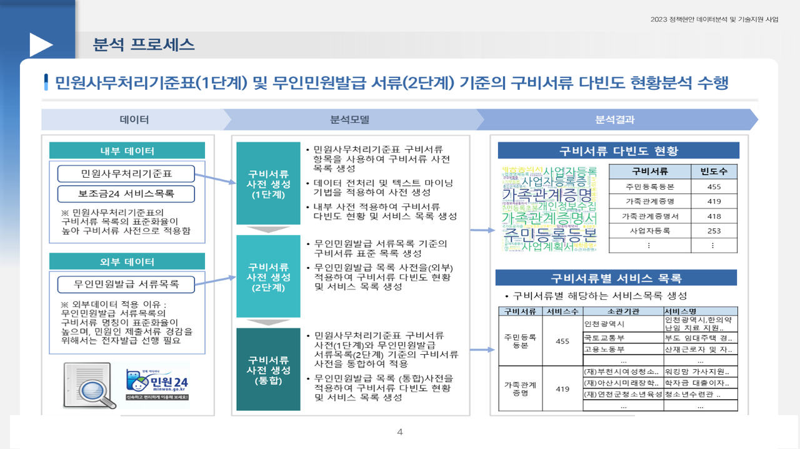
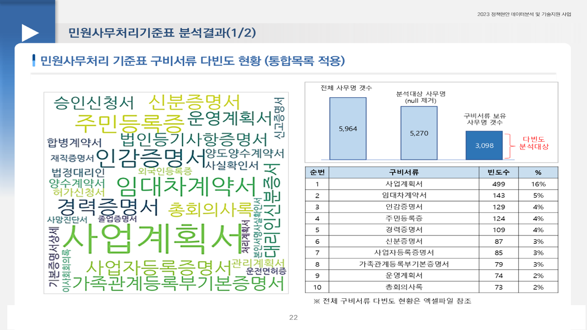

# 디지털플랫폼정부위원회 민원인 제출 구비서류 다빈도 분석

2023.03 – 2023.05 · 라임솔루션 / 디지털플랫폼정부위원회(행정안전부 소관부서 협업) · 역할: 전 과정(텍스트 전처리·형태소 분석·유사도·시각화·보고서)

## 프로젝트 소개
민원 신청 시 국민이 직접 발급받아 제출하는 구비서류 중 어떤 서류가 가장 많이 요구되는지(다빈도), 서류별로 어떤 서비스에 쓰이는지를 민원사무처리기준표·보조금24 서비스 목록·무인민원발급기 서류 목록 텍스트로 분석했습니다. 정부 보유 데이터로 대체 가능한 서류의 감축 우선순위를 정하는 근거 자료입니다.

## 문제 정의
- 정부가 이미 보유한 자료인데도 제도 한계로 민원인이 종이서류를 준비하는 경우가 많다. 어떤 구비서류가 가장 많이 요구되며, 대체 우선순위는 무엇인가.

## 데이터
| 데이터 | 출처 | 규모 | 공개 여부 |
|---|---|---|---|
| 민원사무처리기준표(2023.02.15) | 디지털플랫폼정부위원회 | 민원업무 목록 전체 | 공개 기준표 (원천 xlsx **미포함**) |
| 보조금24 서비스 목록 | 정부24 | 분석대상 3,353건 | 미포함 |
| 무인민원발급기 서류 목록 | 정부24 | 2022년 | 미포함 |
| 사용자 사전(고유명사·불용어·삭제어·보조금24 추가어) | 자체 구축 | txt·csv | **`resources/dictionary/`에 포함** |

- `data/sample/민원사무처리기준표_sample.csv`: `00_pre_data.ipynb`가 읽는 컬럼(분류번호·사무명·소관부처·구비서류) 구조의 합성 샘플(60행).

## 분석 방법
1. 구비서류 텍스트 정제 — `< 민원인 제출서류 >` 블록 추출, 특수문자·괄호·번호 제거, 동의어 통일 (`00_*`, `01_01`)
2. 고유명사 사전(`userword.txt`) 등록과 불용어(`stopword*.txt`)·삭제어(`delete_dictionary.txt`) 제거를 반복하며 KoNLPy(customized Twitter) 형태소 토큰화 → 서류별 빈도 집계
3. 1단계 기준표 → 2단계 보조금24 통합목록(`*_assis`) → 3단계 무인발급 포함(`03_*`) 순으로 확장. 각 단계에 `*_compl`(기준표 보완) 노트북 쌍
4. word2vec 유사도로 표기가 다른 동일 서류 묶기, 분류 기준 체계 초안 (`01_03`, `03_03` 사전·불용어 결과)
5. 서류별 적용 서비스(사무명) 목록 추출, 워드클라우드 시각화(`04_wordcloud`), 의뢰기관에 CSV·엑셀 전송


## 기술 스택
- Python, Pandas, KoNLPy(ckonlpy Twitter), gensim word2vec, wordcloud, openpyxl

## 결과
- 분석대상 서비스 3,353건에서 **다빈도 구비서류 TOP**과 서류별 서비스 목록 도출 (예: 사업자등록증 253개 사무, 사업계획서 243개, 농업경영체등록확인서 108개)
- 구비서류 **분류 기준 체계 초안**과 자동 분류 추천 기준 제시 → 구비서류 감축 우선순위 선정 근거




## 실행 방법
- 환경: Python 3.8+, `pandas`, `openpyxl`, `customized_konlpy`(ckonlpy, JDK 필요), `gensim`, `wordcloud`
- 노트북은 `../P1_Data/01.External/...` 상대경로로 원천 엑셀을 읽습니다. 원천이 없으므로 `data/sample/`의 CSV로 바꿔 읽거나 경로를 환경에 맞게 수정하세요.
- 사전 파일 경로(`../P1_Data/01.External/text_dictionary/...`)는 `resources/dictionary/`로 바꿔 지정합니다.
- 실행 순서: `00_pre_data` → `00_pre_stand` → `01_01` → `01_02_*` → `01_03` → `01_04_*` → `02_01_*` → `03_01` → `03_02_*` → `03_03` → `03_04_*` → `04_wordcloud`

## 폴더 구조
```
civil-document-frequency/
├── notebooks/              # 분석 노트북 17개 (출력 제거)
├── resources/dictionary/   # userword.txt, stopword.txt, stopword9.txt, delete_dictionary.txt, assis_add.csv
├── data/sample/            # 합성 샘플 + README
└── docs/images/            # 보고서 캡쳐
```

## 참고
- Obsidian 노트: `2023-03_디플정_구비서류_빈도분석`
- 원본 분석프로그램 zip의 `.ipynb_checkpoints`(동료 작성 `_shin` 체크포인트 포함)와 결과·패키지·매뉴얼 폴더는 미포함. 공식 보고서·의뢰기관 전송본은 비공개.
