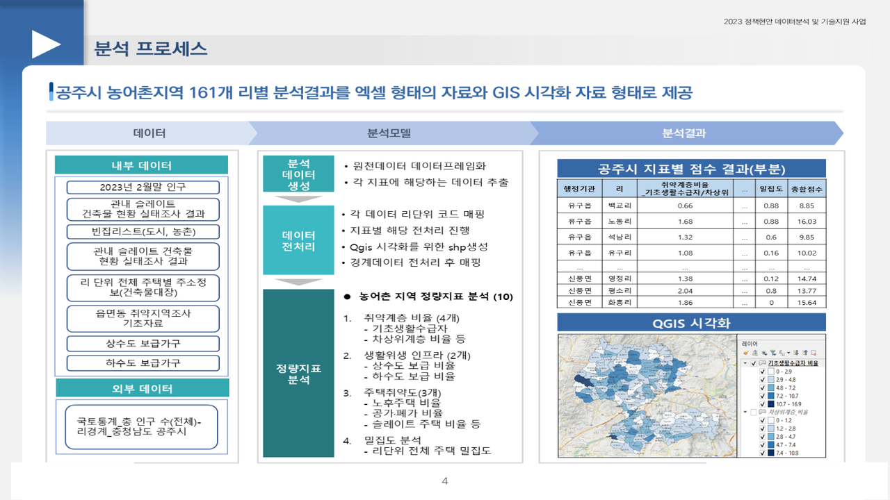
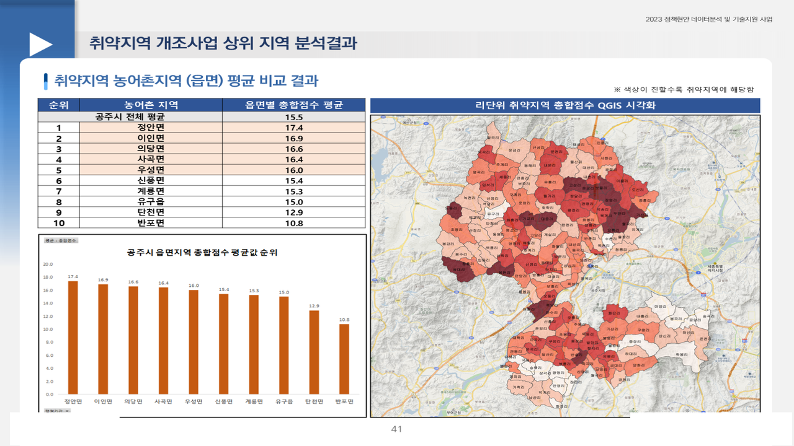

# 공주시 취약지역 생활여건 개조사업 대상지·우선순위 선정

2023.04 – 2023.06 · 라임솔루션 / 충남 공주시 · 역할: 전 과정(데이터 통합·지표 설계·점수 모델·QGIS·보고서)

## 프로젝트 소개
슬레이트 건축물·빈집·인구·상하수도 등 부서별로 흩어진 자료를 리 단위로 통합하고, 농어촌 취약지역 생활여건 개조사업 평가기준에 맞춘 **4개 항목 10개 정량지표**로 리별 취약지역 점수를 산출해 사업 대상지 TOP5와 항목별 취약 원인을 제시했습니다.

## 문제 정의
- 평가 항목이 많고 데이터가 부서별로 흩어져 있어 대상지·시급 지역을 고르기 어렵다. 취약계층 비율·노후주택·위생 인프라 기준으로 리 단위에서 어디가 가장 시급한가.

## 데이터
| 데이터 | 출처 | 규모 | 공개 여부 |
|---|---|---|---|
| 리 단위 인구(2023.2), 65세 이상, 기초수급·차상위·장애인 수 | 공주시 내부 | 리 단위 | 미포함 |
| 슬레이트 건축물 실태조사, 빈집 리스트, 건축물대장 주소 | 공주시 내부 | 건물 단위(소유자·주소 포함) | **개인정보 → 미포함** |
| 상수도 공급가구, 하수도 사용 지역 | 공주시 내부 | 가구·리 단위 | **개인정보 → 미포함** |
| 리 경계 + 총인구 | 국토정보플랫폼 | shp | 공개 (미포함) |

- `data/sample/ri_indicators_sample.csv`: 점수환산 단계 입력(리 단위 지표표)의 구조를 따른 합성 샘플(80행).

## 분석 방법
1. 내부 9종 + 외부 1종을 리 단위로 집계·통합 (`notebooks/01_pre_data_분석.ipynb` 전반부, 초기 탐색은 `notebooks/99_draft/`)
2. 10개 지표 산출: 기초생활수급자·차상위계층·장애인·65세이상고령자 비율, 상수도·하수도 보급률, 30년이상 노후주택·빈집·슬레이트주택 비율, 밀집도(주택 중심점 200m/400m 버퍼 내 주택 수 비율)
3. 지표별 **Min-Max 스케일링** → 항목별 평균 → 가중치(취약계층 6·4, 위생 인프라 4·4(역방향), 주택 취약도 5·5·2, 밀집도 4) 곱해 **총합점수**
4. 상위 지역 TOP5의 항목별 취약 원인 분해, 지표별 빈도 그래프
5. 리 경계에 점수를 매핑해 gpkg로 저장 → QGIS 지도화

상세 산식은 [`docs/methodology.md`](docs/methodology.md), 재구성 예시 스크립트는 [`src/score_model_example.py`](src/score_model_example.py)를 참고하세요.


## 기술 스택
- Python, Pandas, GeoPandas, Scikit-learn(MinMaxScaler), Matplotlib, QGIS

## 결과
- 리 단위 취약지역 **TOP5 대상지** 선정 (예: 4위 우성면 죽당리는 8개 항목 중 7개가 시 평균보다 취약, 주택취약도·취약계층비율 순)
- 시장·부시장 보고용 결과보고서, 전 부서 공유




## 실행 방법
- 환경: Python 3.8+, `pandas`, `geopandas`, `scikit-learn`, `matplotlib`, `openpyxl`
- 노트북의 `../P1_Data/...` 경로는 원천(비공개) 기준입니다. 경로를 환경에 맞게 수정하세요.
- 점수 모델만 확인하려면: `python src/score_model_example.py` (기본으로 `data/sample/ri_indicators_sample.csv`를 읽어 `총합점수` 상위 5개 리를 출력)

## 폴더 구조
```
gongju-vulnerable-area/
├── notebooks/
│   ├── 01_pre_data_분석.ipynb   # 통합 → 지표 → Min-Max → 가중 합산 → gpkg (최종본)
│   └── 99_draft/               # 지표별 초기 탐색 노트북 5개
├── src/score_model_example.py  # 점수 산식 재구성 예시 (샘플로 실행 가능)
├── docs/methodology.md         # 지표·가중치·산식 정리
├── data/sample/
└── docs/images/
```

## 참고
- Obsidian 노트: `2023-04_공주시_취약지역_우선순위`
- QGIS 프로젝트(.qgz), 결과 csv/gpkg/png, 결과보고서 pptx는 비공개.
