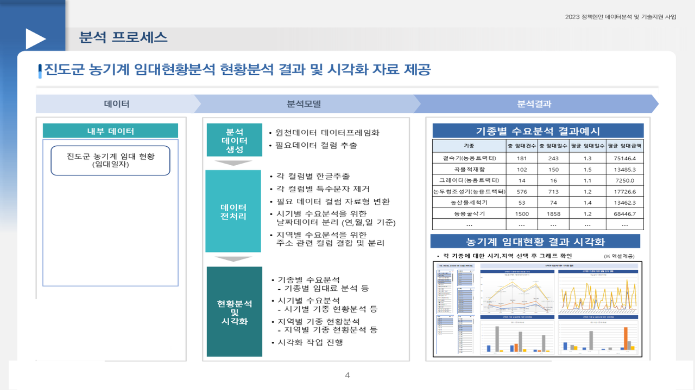

# 진도군 농기계 임대현황 분석

2023.07 – 2023.08 · 라임솔루션 / 전남 진도군 농업기술센터(농기계임대사업소) · 역할: 전 과정(전처리·현황분석·엑셀 시각화·보고서)

## 프로젝트 소개
5년(2018–2023)치 농기계 임대 이력 1종을 기종·시기·지역 세 축으로 나눠 현황을 체계화하고, 담당자가 직접 필터로 조회하는 엑셀 시각화 자료를 제공한 과제입니다.

## 문제 정의
- 시기별로 특정 기종 수요가 폭주해 공급 차질이 생긴다. 어떤 기종이 언제(계절·월) 어디(읍면·리)에서 많이 임대되는가, 5년간 증가·유지·하락 기종은 무엇인가.

## 데이터
| 데이터 | 출처 | 규모 | 공개 여부 |
|---|---|---|---|
| 농기계 임대현황(임대일자, 기종, 읍면·마을, 예약일, 임대일수, 임대금액) | 진도군 내부 | 2018 – 2023, 88개 기종, 130개 리 | 마을 단위 주소 포함 → **원천 미포함** |

- `data/sample/농기계_임대현황_sample.csv`: 노트북이 읽는 엑셀의 사용 컬럼 구조를 따른 합성 샘플(150행).

## 분석 방법 (`notebooks/01_pre_data_pos.ipynb`)
1. 전처리: 컬럼별 한글 추출·특수문자 제거, 자료형 변환, 날짜 분리(연·월·일), 주소 컬럼 결합·분리
2. 기종별: 임대건수·평균/총 임대일수·임대금액 범위와 상·하위 기종, 임대건수 구간 빈도, 임대일수–임대금액 상관
3. 시기별: 월별 임대건수를 사계절로 변환해 계절 비율 산출 → 특정계절·2계절·사계절 사용 기종 분류, 2018 대비 2023 증가율로 증가·유지·하락 기종, 월별 최다 기종
4. 지역별: 리별 임대건수·기종 종류 수, 임대건수와 기종 다양성의 선형관계
5. 연도·월·기종·읍면·리 필터가 있는 엑셀 시각화 자료 제공

```mermaid
flowchart LR
  A[임대현황 원천] --> B[정제 · 날짜/주소 분리]
  B --> C[기종별 현황]
  B --> D[시기(계절·월)별 현황]
  B --> E[지역(읍면·리)별 현황]
  C --> F[엑셀 필터 시각화 · 보고서]
  D --> F
  E --> F
```

## 기술 스택
- Python, Pandas, Matplotlib/Seaborn, Excel(피벗·필터 시각화)

## 결과
- 88개 기종·130개 리의 5년 임대 현황 체계화, 계절 편중 기종과 수요 급증 기종 식별
- 지역별 임대건수가 많을수록 기종 종류도 다양하다는 선형관계 확인
- 담당자가 직접 조회하는 **엑셀 시각화 자료** 제공 → 수요 중심 임대 서비스·예산 배분 근거



## 실행 방법
- 환경: Python 3.8+, `pandas`, `matplotlib`, `seaborn`, `openpyxl`
- 노트북 상단 `pd.read_excel('../P1_Data/01.External/진도군 농기계 임대 현황(임대일자).xlsx')`를 `data/sample/농기계_임대현황_sample.csv`(`pd.read_csv`)로 바꾸면 흐름을 확인할 수 있습니다. 결과 저장 경로(`../P3_Result/...`)도 환경에 맞게 수정하세요.

## 폴더 구조
```
jindo-farm-machinery-rental/
├── notebooks/01_pre_data_pos.ipynb   # 전처리 + 기종·시기·지역 현황 (출력 제거)
├── data/sample/
└── docs/images/
```

## 참고
- Obsidian 노트: `2023-07_진도군_농기계_임대현황`
- 분석프로그램 zip(원천 포함), 결과 CSV·PNG·엑셀 자료, 보고서는 비공개.
