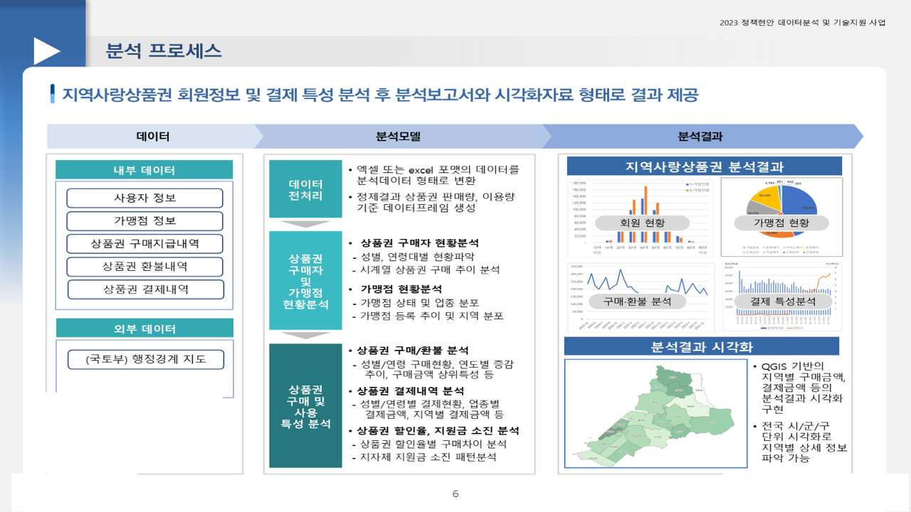
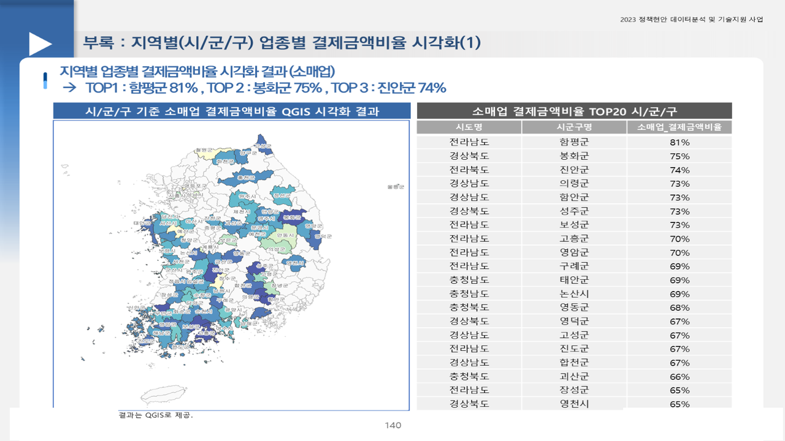

# 한국조폐공사 지역사랑상품권 고객데이터 분석

2023.09 – 2023.12 · 라임솔루션 / 한국조폐공사(전 국민 대상 공사제품 고객데이터 분석 과제) · 역할: 전 과정(대용량 전처리·결제 패턴 분석·지역·업종 QGIS·보고서)

## 프로젝트 소개
모바일 지역사랑상품권의 구매·환불·결제 대용량 데이터(약 64GB)를 pkl/ODS 형태로 분할 변환하고, 누가(성별·연령·지역) 상품권을 얼마나 사고 어디(업종·시군구)에서 쓰는지를 분석해 제품 기획·재고 관리 시사점을 제시한 과제입니다. 라임솔루션 과제 중 가장 큰 데이터를 처리했습니다.

## 문제 정의
- 전 국민 대상 제품(지역사랑상품권 등)의 고객 데이터 분석 자료가 없다. 생산량·재고율 비용 절감과 고객 니즈 파악을 위해 구매·사용 패턴을 알아야 한다.

## 데이터
| 데이터 | 출처 | 규모 | 공개 여부 |
|---|---|---|---|
| 상품권 구매지급내역(회원번호·지자체·수단·금액·할인) | 조폐공사 | 2019 – 2022, 1,048,573건 | 가명처리 → **미포함** |
| 상품권 환불내역 | 조폐공사 | 83,829건 | 미포함 |
| 결제내역(월별 CSV, 결제일시 가명처리), 가맹점 정보 | 조폐공사 | 2020 – 2022, 수십 GB | 미포함 |
| 사용자정보(가명, 핸드폰·생년월일·성별) | 조폐공사 | 회원 단위 | **미포함** (재식별 위험) |
| 시군구 경계 | 통계청 | shp | 공개 (미포함) |

- `data/sample/결제내역_sample.csv`: `00_pre_data_ODS.ipynb`가 월별로 읽어 합치는 결제내역 CSV의 구조를 흉내 낸 합성 샘플(200행). 회원번호·가맹점ID는 가짜 값입니다.

## 분석 방법
1. 월별 결제내역 xlsx → CSV → 하나의 pkl(ODS)로 변환, 결제일시 분리, 가맹점·시도/시군구 기준표 결합, 구매지급·사용자정보 pkl 변환 (`00_pre_data_ODS`)
2. 구매·지급 패턴: 지자체·결제수단·연월·구매금액 구간·할인율, 성별·연령대 세그먼트 (`01_pre_data_analysis`, `02_pre_data_analysis_gift`, `02_pre_data_analysis_dis`)
3. 결제 데이터로 시군구·업종별 결제금액 비율 산출 → 시군구 경계와 결합해 QGIS 지도화 (`03_pre_data_analysis_gis`)
4. 고객·지역·업종별 소비 패턴 → 제품 기획·재고 관리 시사점

```mermaid
flowchart LR
  A[구매·환불·결제·사용자(가명) 수십 GB] --> B[ODS 변환 · 정합성 점검]
  B --> C[구매·환불·할인 패턴]
  B --> D[시군구·업종 결제 비율]
  C --> E[보고서 · 결과 보고회]
  D --> F[QGIS 지도] --> E
```

## 기술 스택
- Python, Pandas(대용량 분할 처리·pkl 중간 저장), openpyxl, GeoPandas, QGIS

## 결과
- 시군구별 업종 결제금액 비율 지도(예: 소매업 비율 TOP20 — 함평군 81%, 봉화군 75% …, 음식점업 TOP1 울릉군 57%)
- 고객·지역·업종별 소비 패턴 분석보고서 → 제품 기획·생산·고객센터 결과 보고회 자료




## 실행 방법
- 환경: Python 3.8+, `pandas`, `numpy`, `openpyxl`, `geopandas`, `tqdm`, `seaborn`, `statsmodels`, `scikit-learn`(`com_fun.py`가 import)
- 노트북은 같은 폴더의 `com_fun.py`(라이브러리 임포트·한글 폰트 설정만 담긴 공통 임포트 모듈)를 `from com_fun import *`로 불러옵니다.
- `../P1_Data/01.External/...` 경로는 원천(비공개) 기준이므로 환경에 맞게 수정하세요. 실행 순서: `00` → `01` → `02_gift` → `02_dis` → `03_gis`.

## 폴더 구조
```
komsco-voucher-customer/
├── notebooks/
│   ├── 00_pre_data_ODS.ipynb … 03_pre_data_analysis_gis.ipynb   # 5개 (출력 없음)
│   └── com_fun.py            # 공통 임포트 모듈
├── data/sample/
└── docs/images/
```

## 참고
- Obsidian 노트: `2023-12_조폐공사_지역사랑상품권_고객분석`
- 원본 패키지 A29.zip(17GB)에서 `P2_Module`의 노트북·`com_fun.py`만 추출했습니다. 집계 결과 엑셀·shp·QGIS 프로젝트·보고서 pdf는 비공개.
