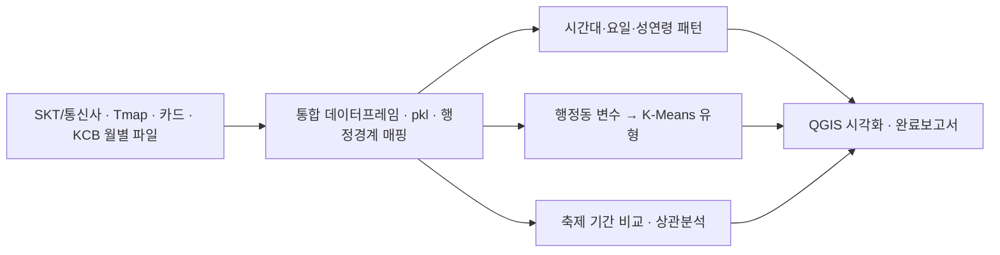
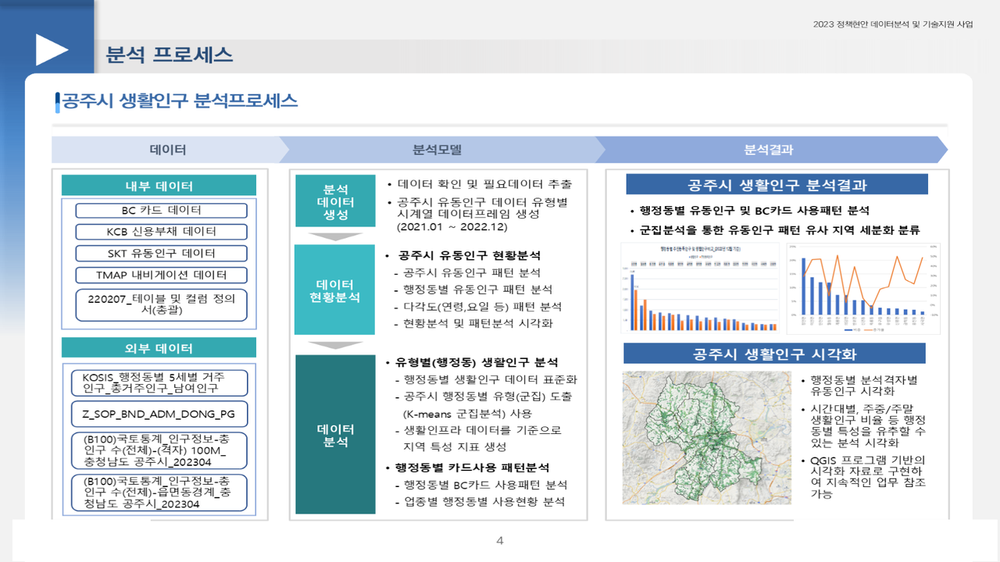
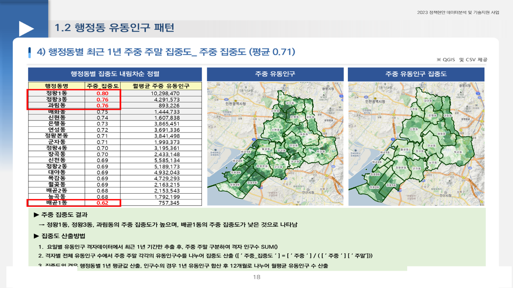

# 생활인구 분석 — 공주시 · 시흥시

2023.08 – 2023.10 · 라임솔루션 / 충남 공주시(인구정책 담당), 경기 시흥시 · 역할: 전 과정(데이터 통합·패턴 분석·군집·축제 효과·보완 대응·보고서), 두 과제 동시 수행

## 프로젝트 소개
통신사 유동인구·Tmap OD·카드·KCB 데이터를 격자·행정동·시간 단위로 맞춰 통합하고, 거주인구 대비 **생활인구(유동·활동·경제인구)** 의 시공간 패턴을 분석해 행정동을 K-Means로 유형화한 과제입니다. 공주시는 백제문화제 등 축제 효과 분석을, 시흥시는 거북섬동 신설 반영과 보완요청 대응을 추가로 수행했습니다. 공주에서 만든 전처리 구조를 시흥에 그대로 재사용했습니다.

## 문제 정의
- 공주시: 2021년 인구감소지역 지정. 세종·대전·천안·아산 영향으로 정주인구가 줄어 생활인구 관점의 인구 모델이 필요. 2021–2022년 거주인구와 생활인구는 연령·성별·읍면동·월·요일·카드소비별로 어떻게 다른가.
- 시흥시: 체류(유동)인구는 구역·시간·시기별로 어디에 몰리는가, 행정동은 어떤 유형으로 나뉘는가.

## 데이터
| 데이터 | 출처 | 규모 | 공개 여부 |
|---|---|---|---|
| SKT 유동인구(성연령·시간대·요일, 격자) — 공주 | SKT | 2021.01 – 2022.12 | 계약 데이터 → **미포함** |
| 유동인구(성연령·시간대·요일, 격자 shp) — 시흥 | 통신사 | 2020.01 – 2023.04 | 계약 데이터 → 미포함 |
| Tmap OD, BC카드 소비, 카드매출(블록), KCB 소득 | 티맵·카드사·KCB | 행정동·업종 | 미포함 |
| 주요시설·관광지·버스정거장, 행정동 경계, 100m 격자 인구, 주민등록인구 | 공주시·시흥시·국토부·KOSIS | - | 공개 (미포함) |

- `data/sample/GJ_SKT_SX_AGE_FLOW_NOPE_sample.csv`: 공주 `01_data_pkl변환.ipynb`가 읽는 SKT 성·연령별 유동인구 CSV 구조의 합성 샘플(120행). 시흥 입력은 shp라 샘플을 만들지 않았습니다.

## 분석 방법
**공주 (`gongju/`)**
1. 연월별 폴더의 유형별 CSV를 하나의 데이터프레임으로 통합, pkl 변환 (`00_pre_data`, `01_data_pkl변환`)
2. 격자·행정동·시간대·요일·성연령 패턴, 주민등록인구 대비 비교 (`02_생활인구_패턴분석_1`, `03_행정동별_패턴분석_2`)
3. 클러스터링 변수(유동인구 비율·증가율·주중/주말·특정시간 집중도) 생성 → K-Means 행정동 유형 (`04_클러스터링변수생성`, `07.cluster`), 상관분석 (`06.상관분석`)
4. 축제 효과: 백제문화제·구석기축제·수국정원꽃축제 기간 vs 전주 유동인구 비교 (`05.Festival_Analysis`)
5. 카드 사용 패턴(상권·매출·거주지별·재난지원금) 집계 (`src/생활인구_공주시.py`)

**시흥 (`siheung/`)**
1. 월별 shp(성연령·시간·요일) 통합, 100m 격자·수정 행정경계(거북섬동) 매핑 (`00_pre_data`, `01_pre_data`, `02_pre_data`)
2. 격자·행정동·시간대·요일 패턴 (`03_생활인구_패턴분석`, `04_행정동별_패턴분석`)
3. 카드데이터 pkl 변환 후 행정동별 소비 패턴 결합 (`05_카드데이터_pkl변환`)
4. 주민등록 대비 유동인구 비율·주중 집중도·60세 이상 비율·카드 월사용액/증가율/주중비율 표준화 → **K-Means 4유형** (`06_cluster`)



## 기술 스택
- Python, Pandas, GeoPandas, Scikit-learn(K-Means, StandardScaler), Matplotlib, QGIS

## 결과
- 공주: 거주인구 대비 생활인구 격차를 읍면동·시간대별로 정량화, 행정동 유형 도출. **백제문화제 기간 유동인구 206% 증가**(축제 전주 대비) 등 이벤트 효과 수치화. 완료보고서 시장·부시장 보고
- 시흥: 체류인구 이동이 왕성한 지역·시간대 도출, 행정동 **4개 유형**과 유형별 특성표(예: 유형 3 "고령지역 유형" 과림동·매화동·신현동). 완료보고서 + 보완요청 반영본 제출




## 실행 방법
- 환경: Python 3.8+, `pandas`, `geopandas`, `scikit-learn`, `matplotlib`, `openpyxl`
- 노트북의 `../P1_Data/...`, `H:/23project/...`, 스크립트의 `D:\data\...` 경로는 당시 환경 기준입니다. 환경에 맞게 수정하세요.
- 번호 순서대로 실행합니다(공주 00→07, 시흥 00→06).

## 파일명 변경표
| 원본 | 레포 |
|---|---|
| `02_생활인구 패턴분석(1).ipynb` | `gongju/notebooks/02_생활인구_패턴분석_1.ipynb` |
| `03_행정동별 패턴분석(2).ipynb` | `gongju/notebooks/03_행정동별_패턴분석_2.ipynb` |
| `03_생활인구 패턴분석.ipynb` | `siheung/notebooks/03_생활인구_패턴분석.ipynb` |
| `04_행정동별 패턴분석.ipynb` | `siheung/notebooks/04_행정동별_패턴분석.ipynb` |

## 폴더 구조
```
living-population/
├── gongju/
│   ├── notebooks/   # 8개 (출력 제거)
│   └── src/생활인구_공주시.py
├── siheung/
│   └── notebooks/   # 7개 (출력 제거)
├── data/sample/
└── docs/images/
```

## 참고
- Obsidian 노트: `2023-08_공주시_생활인구_분석`, `2023-08_시흥시_생활인구_분석`
- 시흥 폴더의 Tmap 스크립트(`TMAP_시흥시 생활인구.py`)는 동료 작성 파일과 내용이 동일해 미포함. QGIS 프로젝트·완료보고서·보완본은 비공개.
