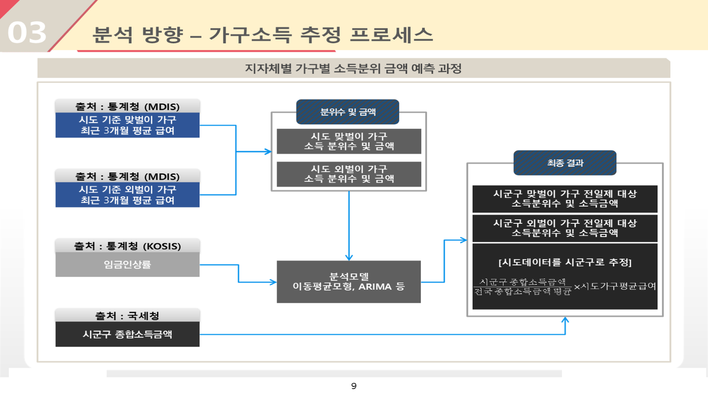

# 교육부 초등전일제(늘봄교실) 수요예측 — MDIS R 집계 코드

2022.08 – 2022.12 · 라임솔루션 / 교육부(행안부 통합데이터분석센터) · 역할: **인턴** — 통계청 MDIS 원격분석환경에서 R 집계 코드 작성, 데이터 수집, 상관분석, Excel 그래프

## 프로젝트 소개
맞벌이 가구 증가로 늘어나는 초등 돌봄 수요에 대응해 초등전일제(늘봄교실)를 우선 적용할 지역·학교를 선별하기 위한 수요예측 과제입니다. 본인은 인턴(산업인턴)으로 참여해 **통계청 MDIS 원격분석환경에서 R 코드를 직접 작성**해 가구 유형(맞벌이·외벌이)별 소득분위 집계표를 산출했고, KOSIS·국세청 데이터 수집과 GDP·종합소득세 상관분석, Excel 대시보드를 맡았습니다. 분석 방법론·ARIMA 인구 예측·보고서는 PM·사수(팀)가 수행했습니다.

이 폴더에는 본인이 작성한 R 스크립트 9개만 담았습니다(팀 노트북·사내 공통모듈 미포함).

## 문제 정의
- 시군구별 맞벌이·외벌이 가구의 소득분위와 돌봄 수요 인구는 어떻게 분포하고, 향후 어떻게 변하는가.

## 데이터
| 데이터 | 출처 | 규모 | 공개 여부 |
|---|---|---|---|
| 지역별고용조사 하반기 C형 마이크로데이터 (코드 상 입력 파일) | 통계청 MDIS 원격분석 | 2015 – 2021 | 반출 제한 — 집계 결과표만 반출, **원천 미포함** |
| 코호트 추계인구, 주민등록인구 | KOSIS·행안부 | 시군구 | 공개 (미포함) |
| 종합소득세, GDP | 국세청·한국은행 | 시도·연도 | 공개 (미포함) |

- `data/sample/mdis_regional_employment_2021_sample.csv`: 2021 스크립트가 읽는 컬럼 구조만 흉내 낸 합성 샘플(150행)입니다. 자세한 설명은 `data/sample/README.md`.

## 분석 방법
1. 막내자녀 연령 7–12세(학령인구) 가구 추출
2. 가구주관계코드로 가구주·배우자 식별 → 맞벌이(DUAL=1)/외벌이(DUAL=0) 판정 (2020–2021은 부부 급여 합산 `C16_SUM`)
3. 시도 가중값만큼 행 복제(가중 반영), 급여 0 제외, 시도별 boxplot 기준 이상치 처리
4. 가구 유형×시도별 소득 10분위(quantile) 산출 → 분위 구간별 가구 수 집계
5. `YEAR, DUAL, SIDO_CODE, SIDO_NM, QUANTILE, MAX_Q, MIN_Q, CNT_Q` 결과표를 CSV로 반출

```mermaid
flowchart LR
  A[MDIS 원격 R 집계] --> B[가구 유형별 소득분위]
  C[KOSIS · 국세청 수집] --> D[상관분석 · 인구 예측(팀)]
  B --> E[Excel 대시보드 · 보고서]
  D --> E
```

## 기술 스택
- R(dplyr·tidyr·tidyverse·reshape2), MDIS 원격분석환경, Excel(피벗·그래프)

## 결과
- 전국 시군구 단위 가구 유형별 소득분위·수요 인구 예측 결과와 수요 우선도 보고서 교육부 제출
- 두 예측방안(코호트 추계인구 vs 주민등록 이동평균) 모두 평균 95% 이상 정확도, 사용자 편의성이 높은 코호트 추계인구 방안 권장(팀)
- 사용자·운영자·공통모듈 매뉴얼로 패키지 인계



## 실행 방법
- 환경: R 4.x, `dplyr`, `tidyr`, `tidyverse`, `reshape2`
- 스크립트의 `H:/Microdata/...`, `I:/R-library/...` 경로는 **MDIS 원격분석환경 기준**입니다. 로컬에서 돌리려면 `read.csv()` 경로와 `write.csv()` 경로를 환경에 맞게 수정하세요.
- 연도별 스크립트가 독립 실행되며(`sido_res_2015.R` … `sido_res_2021.R`, `all_res_2020.R`, `all_res_2021.R`), 연도마다 컬럼 번호(C15/C16, C19/C20 등)가 다르므로 상단 주석을 참고하세요.

## 폴더 구조
```
neulbom-demand-mdis-r/
├── src/            # MDIS에서 작성한 R 스크립트 9개 (cp949 → UTF-8 변환)
│   ├── sido_res_2015.R … sido_res_2021.R   # 시도 기준 소득분위
│   └── all_res_2020.R, all_res_2021.R      # 전국 기준 소득분위
├── data/sample/    # 합성 샘플 + README
└── docs/images/    # 보고서 캡쳐
```

## 참고
- Obsidian 노트: `2022-08_교육부_늘봄교실_수요예측`
- 팀 노트북(S0/S1)·공통모듈(com_module)은 동료 작성으로 미포함. 공식 보고서·매뉴얼은 비공개.
