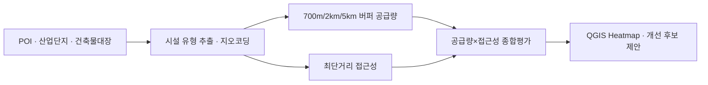
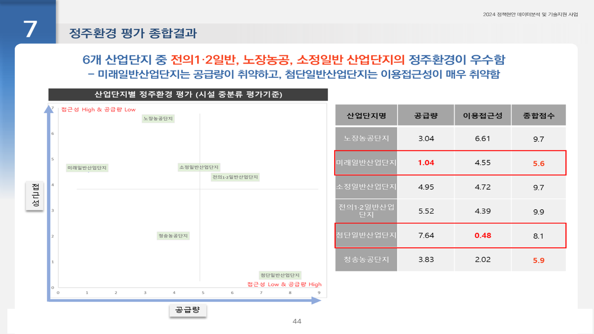

# 세종시 북부권 산업단지 정주여건 개선 분석

2024.05 – 2024.07 · 라임솔루션 / 세종특별자치시 · 역할: 전 과정(데이터 수집·전처리·GIS 접근성 분석·시각화·설문 분석·보고)

## 프로젝트 소개
전의·전동·소정면 등 산업단지가 몰린 세종 북부권의 정주여건 개선 중장기 계획을 위해, 국가관심지점(POI)·건축물대장으로 정주시설 데이터를 만들고 산업단지별 **공급량(배후권역 내 시설 수) × 접근성(최단거리)** 2축으로 종합 평가한 과제입니다. 근로자 설문조사 결과도 교차 분석했습니다.

## 문제 정의
- 산업단지별로 어떤 정주시설 유형이 공급·접근성 면에서 취약한가. 산업단지 정주환경 개선 → 중소기업 고용난·청년실업 완화.

## 데이터
| 데이터 | 출처 | 규모 | 공개 여부 |
|---|---|---|---|
| 국가관심지점정보(POI) + 분류코드표 | 국토교통부 국토지리정보원 | 세종·충남·충북 shp | 공개 (용량상 미포함) |
| 산업단지 위치·규모 | 세종시 | 6개 산업단지 | 미포함 |
| 건축물대장 현황(2024.4) 지오코딩 | 세종시 | 건물 단위 | 미포함 |
| 정주여건 설문조사(근로자·기업주) | 세종시 | 응답 원본 | **미포함** |

- `data/sample/poi_facilities_sample.csv`: `1.데이터전처리.py`가 POI와 분류코드를 결합해 만드는 시설 데이터(`poi_0712.csv`) 컬럼 구조의 합성 샘플(100행, geometry는 WKT POINT).

## 분석 방법
1. POI 종별코드(대·중·소·세·세세분류)로 의료·교통·공원·보육·교육·상업 등 정주시설 유형 추출, 건축물대장에서 주거시설 추출, EPSG:5179 변환 → 최종 시설 gpkg (`src/1.데이터전처리.py`)
2. 산업단지별 700m / 2km / 5km 배후권역(버퍼) 생성 후 권역 내 시설 수(공급량) 측정 (`src/2.데이터분석.py`)
3. 산업단지에서 시설 유형별 최단거리 접근성 산출
4. 공급량 × 접근성 2축 평가 → 산업단지별 종합점수, 취약 시설 유형 비교
5. QGIS Heatmap·분포 시각화, 설문조사 결과 교차 분석 (`src/3.설문조사분석.py`)



## 기술 스택
- Python, Pandas, GeoPandas, Shapely, QGIS

## 결과
- 6개 산업단지 종합점수: 전의1·2일반 9.9, 노장농공 9.7, 소정일반 9.7, 첨단일반 8.1, 청송농공 5.9, 미래일반 5.6
- **노장농공단지 시설환경 우수**, **미래일반산단은 공급량 취약**, 첨단일반산단은 이용접근성 매우 취약 → 개선 후보지·항목 제안
- 완료보고서 세종시 제출



## 실행 방법
- 환경: Python 3.8+, `pandas`, `geopandas`, `shapely`, `openpyxl`
- 스크립트는 사내 공통 프레임워크(`config.config_A34`, `utils.functions_*`)로 경로·로그를 설정합니다. 이 모듈은 비공개라 레포에 없으며, DB 관련 import는 `# DB 접속: 사내 모듈 사용 (비공개)` 주석으로 치환했습니다. 실행하려면 `path_data_in`, `path_data_out`, `path_pretreat` 등 경로 변수를 직접 지정하고 `log.info` 호출을 `print`로 바꾸거나 제거하세요.
- 순서: `1.데이터전처리.py` → `2.데이터분석.py` → `3.설문조사분석.py`

## 폴더 구조
```
sejong-industrial-living/
├── src/
│   ├── 1.데이터전처리.py   # POI·건축물대장 → 시설 데이터
│   ├── 2.데이터분석.py     # 버퍼 공급량 · 최단거리 접근성 · 종합평가
│   └── 3.설문조사분석.py   # 설문 교차 분석
├── data/sample/
└── docs/images/
```

## 참고
- Obsidian 노트: `2024-05_세종시_산업단지_정주여건`
- 중간 gpkg·QGIS 프로젝트·완료보고서는 비공개.
