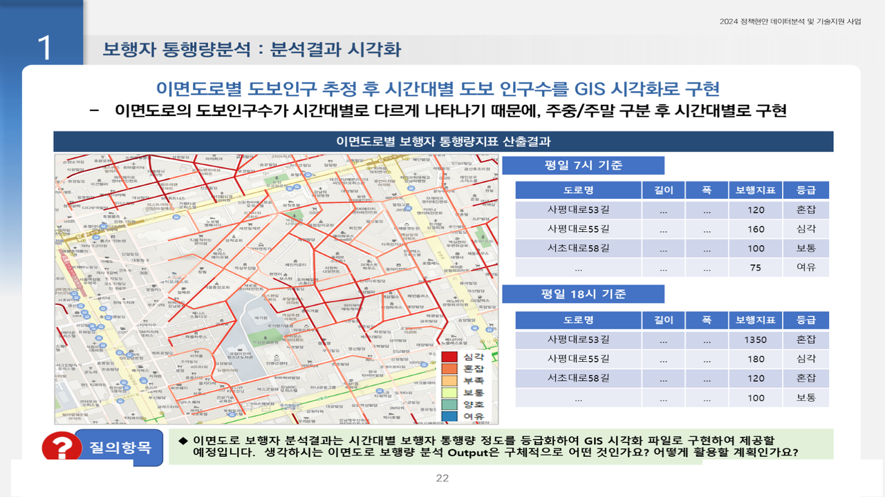

# 서초구 강남역 인구이동 및 상권·이면도로 분석

2024.10 – 2024.12 · 라임솔루션 / 서울 서초구청 스마트도시과 · 역할: 전 과정(데이터 수급·분석·QGIS 시각화·보고)

## 프로젝트 소개
내수침체로 쇠퇴가 우려되는 강남역 상권의 도시계획 정책 근거를 만들기 위해, 서울시 빅데이터캠퍼스에서 신한카드 데이터를 집계·수급하고 생활이동·생활인구·격자 거주인구와 결합해 **서초구 vs 강남구 상권 격차**, 성별·연령·시간대·요일별 소비·이동 패턴, 이면도로 보행·교통 위험 지역을 분석한 과제입니다.

## 문제 정의
- 서초구와 강남구의 상권 격차는 얼마나 되는가, 누가 언제 어디서 소비·이동하는가, 이면도로의 보행·교통 위험 지역은 어디인가.

## 데이터
| 데이터 | 출처 | 규모 | 공개 여부 |
|---|---|---|---|
| 신한카드 사용 데이터(집계구·행정동·업종) | 서울시 빅데이터캠퍼스 | 2023.01 – 2024.07 | 반출 제한 → **미포함** |
| 생활이동(OD), 생활인구 | 서울시 | 행정동·시간대 | 미포함 |
| 100m·250m 격자 거주인구, 행정경계·집계구 | 국토부·통계청 | 서초·강남 | 공개 (미포함) |
| 이면도로·사고·주정차 민원 | 서초구·공공데이터 | 도로 단위 | 미포함 |

- `data/sample/생활이동_유입_sample.csv`: `A29_서초구인구이동.py`가 읽는 유입 데이터의 컬럼 구조를 따른 합성 샘플(150행).

## 분석 방법
1. 격자·행정동·집계구 경계 수집과 EPSG:5181 변환 (`0.수집_전처리.py`)
2. 생활이동 CSV를 월·요일·시간대·출발/도착 행정동으로 집계해 유입·유출 흐름 분석 (`1_생활이동.py`, `A29_서초구인구이동.py`, `5_추가분석.py`)
3. 생활인구 시간대·요일 밀도 분석 (`2_생활인구.py`)
4. 카드 사용액을 가맹점 시군구·행정동·업종·시간대·계절별로 집계해 서초 vs 강남 비교, 상위 업종 TOP10 월별 추이 (`3_카드.py`, `4_카드2.py`, `A29_서초구상권분석.py`)
5. 이면도로 위치별 시간대 보행량과 사고다발·주정차 신고 지역 연관성, QGIS 격자·행정동 시각화


## 기술 스택
- Python, Pandas, GeoPandas, holidays, QGIS

## 결과
- 서초구 **월 406억 원** vs 강남구 **월 1,170억 원** 카드사용액 격차 **2.9배** 정량화
- 시간대·요일별 유동인구 밀도와 소비 패턴을 결합한 상권 활성화 검토 근거 제시
- 정책 근거 보고서 서초구청 제출



## 실행 방법
- 환경: Python 3.8+, `pandas`, `geopandas`, `openpyxl`, `holidays`
- `0.`~`5.` 스크립트는 사내 공통 프레임워크(`config.config_A39`, `utils.functions_*`)로 경로·로그를 설정합니다. 이 모듈은 비공개라 레포에 없으며, DB 관련 import는 `# DB 접속: 사내 모듈 사용 (비공개)` 주석으로 치환했습니다. 경로 변수(`PATH_RESULT3`, `path_data_out` 등)를 직접 지정해 실행하세요.
- `A29_*.py`는 `C:\rawdata\A28`, `D:\10.outfile` 로컬 경로와 중간 pkl을 읽습니다. 환경에 맞게 수정하세요.

## 파일명 변경표
| 원본 | 레포 |
|---|---|
| `1. 생활이동.py` | `src/1_생활이동.py` |
| `2. 생활인구.py` | `src/2_생활인구.py` |
| `3. 카드.py` | `src/3_카드.py` |
| `4. 카드2.py` | `src/4_카드2.py` |
| `5. 추가분석.py` | `src/5_추가분석.py` |

## 폴더 구조
```
seocho-gangnam-commercial/
├── src/          # py 8개
├── data/sample/
└── docs/images/
```

## 참고
- Obsidian 노트: `2024-10_서초구_인구이동_상권분석`
- 카드 데이터 xlsx/gpkg, 전달자료 zip, 보고서는 비공개. README의 금액 수치는 보고서 인용값입니다.
