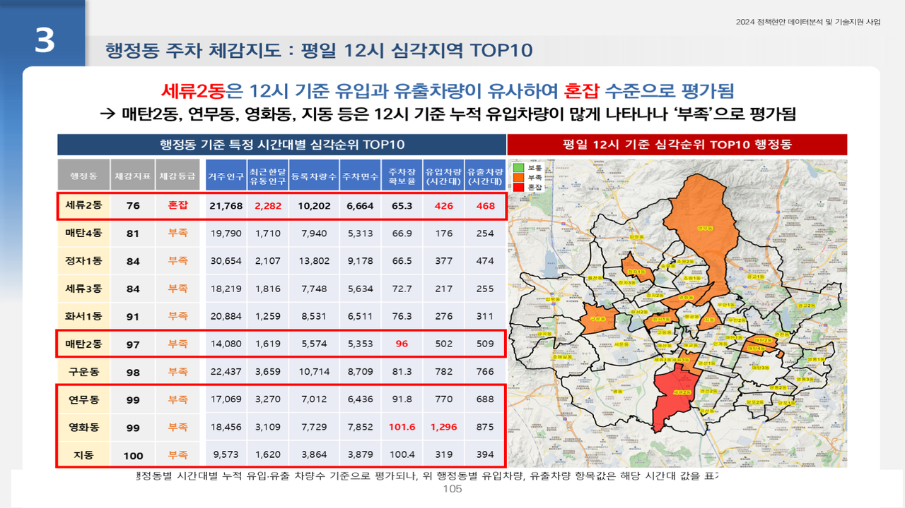

# 수원시 주차 수요·공급 분석

2024.07 – 2024.10 · 라임솔루션 / 경기 수원시청 · 역할: 데이터 구축·수요공급 지표·주차체감지도·사내 MariaDB 적재 (광양시 과제와 동시 수행)

## 프로젝트 소개
건축물대장·차량등록·주차장·불법주정차 민원 데이터를 정제·지오코딩해 기초구역 단위 **공급(주차면)·수요(등록차량·유동인구·민원)** 지표를 만들고, KT 유동·생활·유입유출 인구를 연계해 시간대별 주차체감지도를 제작한 과제입니다. 내부 데이터는 노트북 파이프라인으로 사내 MariaDB에 적재해 SQL로 추출했습니다.

## 문제 정의
- 수원시 전역에서 기초구역별로 공급(주차면)과 수요(등록차량·유동인구·민원)가 얼마나 어긋나는가, 어느 시간대에 부족한가.

## 데이터
| 데이터 | 출처 | 규모 | 공개 여부 |
|---|---|---|---|
| 건축물대장 표제부 + 건축인허가 총괄표제부 | 수원시, 건축HUB | 10,139 + 1,143행 → 10,357행 | 미포함 |
| 차량등록대수(등록주소) | 수원시 | 568,335건 → 567,523건 우편번호 매핑 | 주소 → **미포함** |
| 불법주정차 민원 | 수원시 | 5,714건 → 1,289건 지오코딩 | 미포함 |
| 유동인구·생활인구·유입유출(50m 격자) | KT | 기초구역·시간대 | 계약 데이터 → 미포함 |
| 카드(가맹점·성연령·시간대·유입지), 신용 통계 | 카드사·NICE | 격자·월 | 미포함 |

- `data/sample/T1_GG_50CELL_FLOWPOP_sample.csv`: `S2.0` 노트북의 `d10_유동인구_FLOWPOP` 테이블 DDL에 맞춘 KT 유동인구 CSV 구조의 합성 샘플(120행).

## 분석 방법
1. 공급: 건축물대장 부설주차장(옥내·옥외, 기계식·자주식) + 공영·민영 주차장 면수 산출, 경계면 좌표계(EPSG:5179) 통일 (`1.전처리및현황분석.py`)
2. 수요: 등록차량(우편번호·기초구역 매핑), 유동·생활인구(평일 12시·20시 등), 민원 위치 (`2.수요공급분석.py`, `3_인구데이터.py`)
3. 내부 데이터 CSV → MariaDB 적재(`S2.0`), 유동인구·서비스인구 SQL 추출·엑셀 저장(`S2.1`, `S2.2`)
4. 기초구역별 주차체감지표(시간대별) 산출, 배후지역 세분화(K-Means·PCA) 시각화 (`4.배후지역세분화_시각화.py`, `A28_수원시주차장_3.py`, `A28_수원시주차장_주차체감지도.py`)
5. 중간보고 이후 추가 분석·수정 (`5.추가분석및수정.py`)


## 기술 스택
- Python, Pandas, GeoPandas, Shapely, Scikit-learn(KMeans·PCA), SQL(MariaDB), QGIS

## 결과
- 기초구역 단위 수요·공급 데이터셋 구축(건축물대장 10,357행, 차량 567,523건 매핑, 민원 1,289건 좌표화). 주소 품질(우편번호 실패 808건, 민원 정좌표 529건)을 먼저 수치로 보고
- 시간대별 주차체감지도와 배후지역 세분화 결과를 중간·결과보고서로 제출



## 실행 방법
- 환경: Python 3.8+, `pandas`, `geopandas`, `shapely`, `pyproj`, `scikit-learn`, `scipy`, `openpyxl`
- 스크립트·노트북은 사내 공통 프레임워크(`config.config_A28`, `utils.functions_*`)로 경로·로그·DB 접속을 처리합니다. 이 모듈은 비공개라 레포에 없으며, **DB 접속 관련 import와 `f_get_conn(...)` 호출은 `# DB 접속: 사내 모듈 사용 (비공개)` 주석으로 치환**했습니다. 노트북 출력(접속 로그 포함)은 모두 제거했습니다.
- 실행하려면 경로 변수(`path_data_in` 등)를 직접 지정하고, DB 구간은 본인 환경의 커넥션으로 대체하세요. `S2.0`의 CREATE TABLE DDL과 `S2.1`/`S2.2`의 SQL은 그대로 참고할 수 있습니다.
- 순서: `S2.0` → `S2.1`/`S2.2` → `1.` → `2.` → `3_` → `4.` → `A28_*` → `5.`

## 파일명 변경표
| 원본 | 레포 |
|---|---|
| `3. 인구데이터.py` | `src/3_인구데이터.py` |
| `4.배후지역세분화 시각화.py` | `src/4.배후지역세분화_시각화.py` |

## 폴더 구조
```
suwon-parking-supply-demand/
├── src/          # py 7개
├── notebooks/    # S2.0 내부_DATA_to_DB, S2.1 유동인구_DATA, S2.2 서비스인구_DATA (출력 제거)
├── data/sample/
└── docs/images/
```

## 참고
- Obsidian 노트: `2024-07_수원시_주차_수요공급`
- `1.전처리및현황분석.py` 안의 동료 작성 구간(총괄표제부·표제부 중복 규칙 코드)은 제거하고 안내 주석으로 대체했습니다. `temp/` 임시 노트북, gpkg/pkl 중간 산출물, 중간·결과보고서는 비공개.
